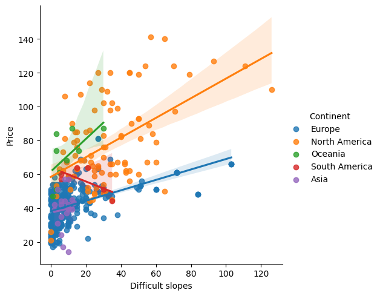

# Ski Pass Price Prediction

I built and compared models to predict how much a one-day adult ski pass costs based on a resort’s slopes, location, season, and services.

**Project Type:** Regression | **Tools:** Python, Pandas, NumPy, statsmodels, SciPy, scikit-learn, Matplotlib, Seaborn

## Main Result

I chose Ridge regression as the final model. When tested, its predicted prices were off by about **€9.29 on average**.

| Test metric | Result |
| --- | ---: |
| R-squared | 0.568 |
| Mean absolute error (MAE) | €9.287 |
| Root mean squared error (RMSE) | €12.131 |

R-squared shows how well the model explains differences in ski pass prices. MAE shows, on average, how far off the predicted prices are from the actual prices. RMSE also measures these price errors, but large mistakes affect its score more than they affect MAE.



This chart shows the relationship between difficult slopes and ski pass prices in different continents. Each dot represents a ski resort, and each color stands for a continent. The lines show whether resorts with more difficult terrain tend to charge higher or lower prices. These lines show patterns in the data, not predictions from the final Ridge model.

## Business Question

How well can ski resort features help predict and compare ski pass prices?

## Data Source

This project uses the resorts.csv file from [Maven Analytics’ Ski Resorts dataset](https://mavenanalytics.io/data-playground/ski-resorts), which contains the locations, prices, slopes, lifts, and seasons of about 500 ski resorts worldwide. The separate snow-cover dataset is not used.

## Data and Workflow

- The starting dataset had 24 columns and 499 rows, one for each ski resort, with resort IDs as the row labels.
- Checked the data types, how values were spread out, unusual prices, and the relationships between resort features.
- Built linear regression models and checked their prediction errors. Also checked whether some features provided similar information.
- Tried combining features and using categories such as continent and season.
- Compared the earlier models with Ridge and Lasso regression.
- Used 80% of the data to train the models and 20% to test them. Also used cross-validation, which checks performance using different training and validation groups.

## Final Model Comparison

| Model | Test R-squared | Test MAE (€) | Test RMSE (€) |
| --- | ---: | ---: | ---: |
| Refined linear model | 0.230 | 11.580 | 16.189 |
| Interaction model | 0.501 | 10.172 | 13.028 |
| Categorical model | 0.559 | 9.423 | 12.250 |
| Ridge | 0.568 | 9.287 | 12.131 |
| Lasso | 0.560 | 9.377 | 12.232 |

## Key Findings

Adding categories, such as continent and season, helped the model predict prices better than the earlier model that used only numbers. Ridge gave the best results among the final models tested, but some predicted prices were still too high or too low.

The model could be a starting point for estimating ski pass prices. More data about customer demand, resort popularity, snowfall, holidays, and nearby competitors could help improve its predictions.

## Files

- [Full Notebook](ski_pass_price_prediction.ipynb): The project’s code, explanations, charts, and saved results.
- [Data Instructions](DATA.md): Where the data came from and which data file to download.
- `requirements.txt`: A list of Python packages and suggested versions for running the project.
- `images/`: The chart saved from the notebook is shown in this README.

## How to Run in Google Colab

1. Open [Google Colab](https://colab.research.google.com/). Choose **File > Upload notebook** and select ski_pass_price_prediction.ipynb.
2. Download resorts.csv by following the instructions in [DATA.md](DATA.md).
3. In Colab’s **Files** panel, upload resorts.csv to the /content folder. Keep the filename the same so the notebook can find it.
4. Run the notebook cells from top to bottom.

Colab runs the notebook in your browser, so you do not need to install or open Jupyter on your computer.

If a Python package is missing or does not work with the notebook, upload requirements.txt to Colab’s /content folder. Add a new code cell at the top of the notebook and run:

```python
%pip install -r requirements.txt
```

If Colab asks you to restart, do so, then run the notebook cells again from top to bottom. The suggested package versions still need to be checked together to confirm that the setup works.

Files uploaded to Colab are temporary. You may need to upload your CSV again when you start a new session.

You can also view the saved results on GitHub without downloading the data or running the notebook.

## Limits and Next Steps

The dataset has a limited number of ski resorts. Adding more resorts and information about customer demand and other business factors could help improve the predictions. These results show patterns in prices, but they do not prove why some resorts charge more.

The final model was chosen by comparing each model’s test results. In the future, I would use only the training data to choose the model and save a separate, unused dataset for the final test. During cross-validation, the rules for putting numbers on a similar scale should also be based only on the training data in each round.
