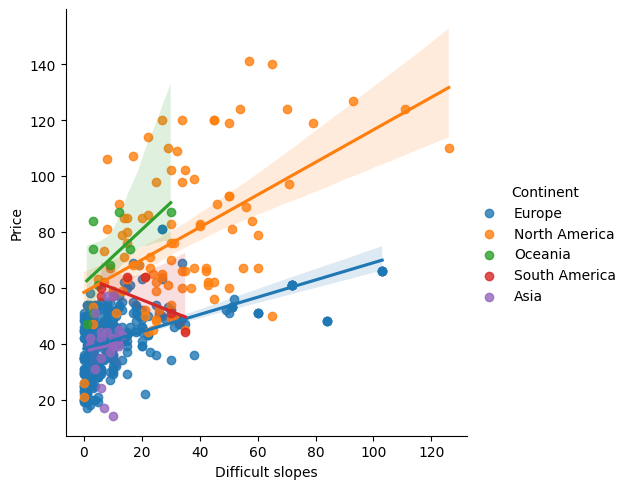

# Ski Pass Price Prediction

I built and compared regression models to estimate the price of a one-day adult ski pass using a ski resort's slopes, location, season, and amenities. 

**Project Type:** Regression

**Tools:** Python, Pandas, NumPy, statsmodels, SciPy, scikit-learn, Matplotlib, Seaborn, Google Colab

## Main Result and Model Comparison

As shown in the table below, Ridge had the lowest average prediction error of **€9.29** for the **98 resorts used for testing**, which was only **€0.14 lower** than the categorical model’s.

| Model | Test R-squared | Test MAE (€) | Test RMSE (€) |
| --- | ---: | ---: | ---: |
| Refined linear model | 0.230 | 11.580 | 16.189 |
| Interaction model | 0.501 | 10.172 | 13.028 |
| Categorical model | 0.559 | 9.423 | 12.250 |
| **Ridge — selected model** | **0.568** | **9.287** | **12.131** |
| Lasso | 0.560 | 9.377 | 12.232 |

## Data Source

The project uses `resorts.csv` from [Maven Analytics’ Ski Resorts Dataset](https://mavenanalytics.io/data-playground/ski-resorts). The separate snow-cover dataset is not used. See [DATA.md](DATA.md) for more information about the data and how to download it. 

## Workflow

- Removed **9 resorts with questionable €0 prices**.
- Examined pricing patterns, regression assumptions, prediction errors, and multicollinearity.
- Tested combined features, the interaction between difficult slopes and North America, and categorical inputs to improve predictions.
- Compared linear, Ridge, and Lasso regression with an **80/20 train-test split** and **five-fold cross-validation**. Scaled inputs and tuned Ridge and Lasso.

## Key Findings

- Test MAE decreased from **€11.58** for the refined linear model to **€9.42** for the categorical model and **€9.29** for Ridge, although some prediction errors were still large.

- Overall, resorts with more difficult terrain tended to charge more; however, the relationship differed by continent.



Each dot represents a ski resort, while each color stands for a different continent. The lines show the relationship between ski pass prices and difficult slopes for each continent, rather than final Ridge model predictions.

## Possible Use and Limitations

- The model could give a starting price estimate for comparing resorts, but has not been tested in real pricing decisions and does not prove what causes higher prices. More data on visitor demand, snowfall, holidays, resort popularity, and competitors' prices could improve predictions.

- Some feature choices used the full dataset, the final model was chosen using test results, and scaling was fitted before cross-validation. The reported scores are therefore not a fully independent estimate of performance on new resorts.

- In the future, I would choose features and models through cross-validation on training data, calculate scaling from each round’s training group, and test the final model on untouched data.
  
## Files

- [Full Notebook](ski_pass_price_prediction.ipynb): Project code, explanations, charts, and saved results.
- [Data Instructions](DATA.md): Where to download the data and which file to use.
- `requirements.txt`: Required Python packages with suggested versions.
- `images/`: The chart saved from the notebook and displayed in this README.

## How to Run in Google Colab

1. Open [Google Colab](https://colab.research.google.com/). Choose **File > Upload notebook** and select `ski_pass_price_prediction.ipynb`.
2. Download `resorts.csv` by following the instructions in [DATA.md](DATA.md).
3. In Colab’s **Files** panel, upload `resorts.csv` to `/content`. Keep the filename the same so the notebook can find it.
4. Run the notebook cells from top to bottom.

If a Python package is missing or does not work with the notebook, upload `requirements.txt` to Colab’s `/content` folder. Add a new code cell at the top of the notebook and run:

```python
%pip install -r requirements.txt
```

If Colab asks you to restart, do so, then run the notebook cells again from top to bottom. The suggested package versions still need to be checked together to confirm that the setup works.

You can also view the saved results on GitHub without downloading the data or running the notebook.
