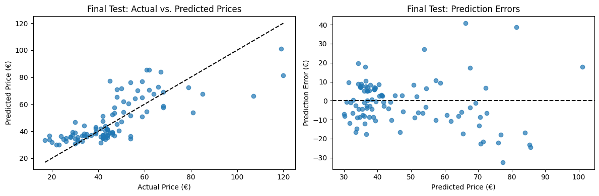
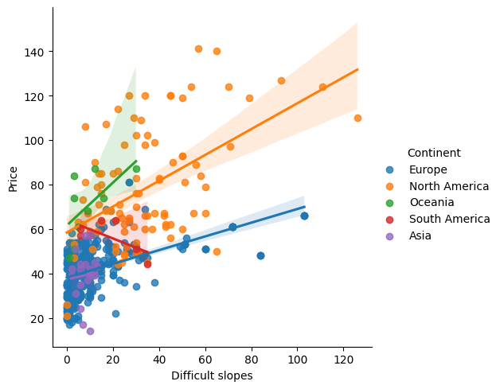

# Ski Pass Price Prediction

I built and compared different regression models to predict the listed price of a one-day adult ski pass. I used information about each resort, such as its slopes, location, season, and services.

**Project type:** Machine learning (regression)  
**Tools:** Python, pandas, NumPy, scikit-learn, statsmodels, SciPy, Matplotlib, Seaborn, Google Colab

## Main Result

**Lasso regression** was chosen because it had the lowest average prediction error during cross-validation on the training data. I then tested it on the **98 resorts set aside for final testing**.

| Final test result | Value |
|---|---:|
| Average prediction error (MAE) | **€9.28** |
| RMSE | €12.15 |
| R² | 0.566 |
| Baseline average error (MAE) | €14.19 |

The Lasso model's predictions were off by about **€9.28 on average**. That was better than the simple baseline, which predicted the same average training price for every test resort and was off by **€14.19 on average**.

## Model Comparison

I compared six models using **five-fold cross-validation on the training data**. The model with the lowest average MAE was selected for final testing.

| Model | Cross-validation MAE (€) |
|---|---:|
| **Lasso — selected model** | **8.83** |
| Ridge | 8.84 |
| Categorical model | 8.87 |
| Interaction model | 8.97 |
| Refined linear model | 11.18 |
| Feature-engineered model | 12.62 |

Lasso and Ridge had very similar results. Lasso was selected because its average prediction error was slightly lower. **The 98 test resorts were not used to choose the final model in this version.**

## Data Source

I used [`resorts.csv` from the Maven Analytics Ski Resorts dataset](https://mavenanalytics.io/data-playground/ski-resorts). The separate snow-cover dataset was not used. See [`DATA.md`](DATA.md) for download instructions.

The original file contained **499 resorts**. I removed **9 resorts with €0 pass prices**, leaving **490 resorts**: **392 for training** and **98 for final testing**.

## What I Did

1. Cleaned the data and set aside 98 resorts for final testing.
2. Looked at how ski pass prices were related to slopes, location, season, and resort services.
3. Tested linear regression models, new features, Ridge, and Lasso.
4. Used cross-validation to compare the models and find the best settings for Ridge and Lasso.
5. Tested the chosen Lasso model on the 98 resorts and compared its results with the baseline.

## Graphs and Findings

### Final Test Results



The graph on the left compares actual prices with the model's predictions. The graph on the right shows where the model's predictions were too high or too low. Some of the more expensive resorts had larger prediction errors.

### Ski Pass Prices and Difficult Slopes by Continent



Each dot represents a resort, and each color represents a continent. The lines show how difficult slopes and prices are related in the **training data**. They are **not** predictions from the final Lasso model.

**Other findings:** Adding location, season, and resort services improved the average prediction error compared with the refined model that used only numerical features. The new numerical features on their own did not improve the results in that comparison.

## Limitations and Next Steps

The model can help compare ski pass prices, but it has not been tested for real pricing decisions. The results also do not prove what causes prices to change.

The dataset does not include snowfall, holidays, visitor numbers, resort popularity, or prices at nearby resorts. These could be useful to study in the future.

An earlier version of this project looked at the full dataset. In this revised version, the 98 test resorts were kept separate when choosing features and models. Still, **testing on completely new resorts or prices from another ski season would give a stronger check** of how accurate the model really is.

## Files

- [`ski_pass_price_prediction.ipynb`](ski_pass_price_prediction.ipynb) — Full notebook with code, graphs, explanations, and results.
- [`DATA.md`](DATA.md) — Where to get the dataset.
- [`requirements.txt`](requirements.txt) — Python packages used for the project.
- [`images/`](images/) — Graphs shown in this README.

## How to Run in Google Colab

1. Open `ski_pass_price_prediction.ipynb` in [Google Colab](https://colab.research.google.com/).
2. Download `resorts.csv` using the instructions in `DATA.md`.
3. Upload `resorts.csv` to Colab's **Files** panel. Keep the filename the same.
4. Run the notebook cells from top to bottom.

If a package is missing or doesn't work with the notebook, upload `requirements.txt` to Colab and run this in a new code cell:

```python
%pip install -r requirements.txt
```

If Colab asks you to restart, restart it and run the cells again.

You can also read the notebook and see its saved results on GitHub without running the code.
